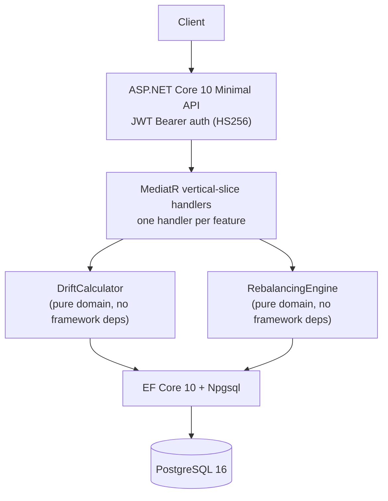

# Portfolio Rebalancer


A REST API for investment portfolio drift detection and rebalancing order generation. Given a portfolio's target allocation and current market prices, it calculates drift per position and generates buy/sell orders to restore balance.

**[Try it: rebalancer.coreystevens.dev](https://rebalancer.coreystevens.dev/)**: the page holds a real bearer token, so opening a second tab gets a different user who cannot read the first one's holdings. Swagger is at [/swagger](https://rebalancer.coreystevens.dev/swagger).

Deploy via Terraform and run on EC2 (see [Deployment](#deployment)), or spin up locally with `docker compose up`.

## Problem

Maintaining a target asset allocation requires periodic rebalancing as market prices shift positions away from their targets. Doing this manually across multiple portfolios is error-prone: it requires computing weighted values, comparing to targets, and sizing orders correctly while selling before buying.

## Solution

A stateful REST API that persists portfolio definitions (target allocations, drift tolerance) and purchase history (lots with cost basis), then computes drift and generates orders on demand. Sells are always sequenced before buys so proceeds fund purchases.

## Architecture



All drift calculation and order generation is pure domain logic with no framework dependencies. Handlers are thin: load from DB, call domain service, persist result, return DTO.

## Tech Stack

| Layer | Technology | Why |
|---|---|---|
| Runtime | ASP.NET Core 10 (.NET 10 LTS) | Enterprise .NET standard; Minimal API eliminates controller boilerplate |
| Architecture | MediatR 12 (CQRS, vertical slices) | One handler per feature; avoids service-layer sprawl |
| ORM | EF Core 10 + Npgsql | Fluent API config, typed migrations, PostgreSQL-native types |
| Database | PostgreSQL 16 | Reliable, decimal-safe arithmetic (no float rounding in financial math) |
| Auth | JWT HS256 (JwtBearer 10) | Stateless; UserId claim scopes every query to the calling user |
| Testing | xUnit + TestContainers.PostgreSql + FluentAssertions | Integration tests hit a real PostgreSQL container, not SQLite or mocks |
| Infra | Terraform (AWS EC2 t2.micro + RDS db.t3.micro) | Free-tier eligible; OIDC GitHub Actions deploy (no stored credentials) |

## API Reference

All `/api/*` endpoints require `Authorization: Bearer <jwt>`.

| Method | Path | Description |
|---|---|---|
| GET | `/health` | liveness check |
| POST | `/api/portfolios` | create portfolio with target allocations |
| GET | `/api/portfolios/{id}` | get portfolio |
| POST | `/api/portfolios/{id}/holdings` | add a holding with purchase lots |
| POST | `/api/portfolios/{id}/drift` | calculate drift (body: `{ prices: {...} }`) |
| POST | `/api/portfolios/{id}/rebalance` | generate and persist rebalancing orders |
| GET | `/api/portfolios/{id}/rebalance` | rebalancing history |

### Example: Create and rebalance

```bash
# Create a 60/40 portfolio with 5% drift tolerance
curl -X POST http://localhost:8080/api/portfolios \
  -H "Authorization: Bearer $TOKEN" \
  -H "Content-Type: application/json" \
  -d '{
    "name": "Core Portfolio",
    "driftTolerancePct": 5.0,
    "allocations": [
      { "ticker": "VTI", "weight": 0.6 },
      { "ticker": "BND", "weight": 0.4 }
    ]
  }'

# Add a holding
curl -X POST http://localhost:8080/api/portfolios/{id}/holdings \
  -H "Authorization: Bearer $TOKEN" \
  -H "Content-Type: application/json" \
  -d '{
    "ticker": "VTI",
    "lots": [{ "shares": 100, "costBasisPerShare": 230.00, "purchasedAt": "2024-01-15" }]
  }'

# Check drift with today's prices
curl -X POST http://localhost:8080/api/portfolios/{id}/drift \
  -H "Authorization: Bearer $TOKEN" \
  -H "Content-Type: application/json" \
  -d '{ "prices": { "VTI": 255.40, "BND": 74.20 } }'

# Generate rebalancing orders (persisted to history)
curl -X POST http://localhost:8080/api/portfolios/{id}/rebalance \
  -H "Authorization: Bearer $TOKEN" \
  -H "Content-Type: application/json" \
  -d '{ "prices": { "VTI": 255.40, "BND": 74.20 } }'
```

**Drift response:**
```json
{
  "totalPortfolioValue": 25540.00,
  "anyOutOfBand": true,
  "positions": [
    { "ticker": "VTI", "targetWeight": 0.6, "actualWeight": 1.0, "driftPct": 40.0, "isOutOfBand": true, "shares": 100, "marketValue": 25540.00 },
    { "ticker": "BND", "targetWeight": 0.4, "actualWeight": 0.0, "driftPct": -40.0, "isOutOfBand": true, "shares": 0, "marketValue": 0.00 }
  ]
}
```

## Getting Started

```bash
cp .env.example .env
# Edit .env with a JWT_SECRET (32+ chars)
docker compose up
```

Swagger UI: `http://localhost:8080/swagger`

Generate a test token:
```bash
# Using jwt-cli (brew install mike-engel/jwt-cli/jwt)
jwt encode --secret "your-secret" --sub "user-id-1"
```

## Running Tests

```bash
# Requires Docker (TestContainers spins up postgres:16-alpine)
dotnet test
```

Tests: 18 unit (domain logic, no DB) + 23 integration (real PostgreSQL via TestContainers), which is the 41 the badge reports. The integration count grew by 14 when `DemoSessionTests` landed; the badge moved and this sentence did not, so for a while the two disagreed four lines apart.

Three decisions have their own records: [MediatR over controllers](docs/adr/ADR-001-mediatr-over-controllers.md), [TestContainers over SQLite](docs/adr/ADR-002-testcontainers-over-sqlite.md), and [per-column numeric scale](docs/adr/ADR-003-numeric-precision-for-financial-values.md).

## Deployment

```bash
cd infra/terraform
cp terraform.tfvars.example terraform.tfvars
# Edit with db_password, jwt_secret, ecr_image_uri

terraform init
terraform apply
```

Outputs the EC2 public IP and ECR repository URL. See [infra/README.md](infra/README.md) for full deployment steps including OIDC setup.

## Domain Design Notes

**Drift formula:** `drift_pct = (actual_weight - target_weight) * 100`. A position is out-of-band when `|drift_pct| > drift_tolerance_pct`.

**Order sizing:** `shares_to_trade = |target_value - actual_value| / price`. Sells generated first (proceeds fund buys).

**Weight validation:** Target allocations are validated to sum to 1.0 at portfolio creation (tolerance: 0.001). The database stores weights as `numeric(8,6)` to avoid floating-point drift.

**Per-user isolation:** Every query filters on `UserId` extracted from the JWT `sub` claim. A user can only see and modify their own portfolios.

## Demo

The page at `/` runs against the real API. Every route here needs a bearer token and nothing issued one, so there was no way to show the thing working.

`POST /api/demo/session` mints a genuine token for a throwaway user and seeds it a portfolio that is already out of band. A read-only bypass would have been less code and would have demonstrated nothing: the point worth showing is that two visitors in two tabs cannot reach each other's holdings, which is what every query filtering by user id at the EF level buys you.

The sample portfolio is a drifted three-fund: equities have run, bonds have lagged. VNQ is left inside the tolerance band on purpose, because a portfolio where every line is flagged does not show that the band does anything.

| Variable | Default | What it does |
| --- | --- | --- |
| `DEMO_SESSION_CAP` | `500` | An anonymous route that writes rows needs a ceiling. Past it the route refuses. |

The cap alone would not have held. A demo token is a real token, so a visitor could call `POST /portfolios` directly and write rows until the ceiling locked every later visitor out: a door with a cap on it next to an open window. Demo tokens carry a `principal_kind` claim, and the two create endpoints require its absence. They keep read, drift and rebalance, which is the whole surface the page drives. The cap counts distinct demo users rather than rows, so it measures sessions handed out and not what any one of them managed to write.

Prices are static. A live quote feed would make the demo depend on a vendor, a key and a budget, and the arithmetic being shown is no more convincing for the prices being today's.

## Known Limitations

- Prices are caller-supplied: there is no market data integration. The caller is responsible for providing current prices at drift/rebalance time.
- Rate limiting is not implemented. Intended as a private API behind authentication.
- Lot-level FIFO sell assignment (tax-loss harvesting order) is not implemented. Orders specify share counts only.
- In-production HTTPS requires a reverse proxy (nginx or ALB with ACM certificate) in front of the container.
- The free-tier RDS instance (db.t3.micro) has limited IOPS; not suitable for high-volume workloads.
